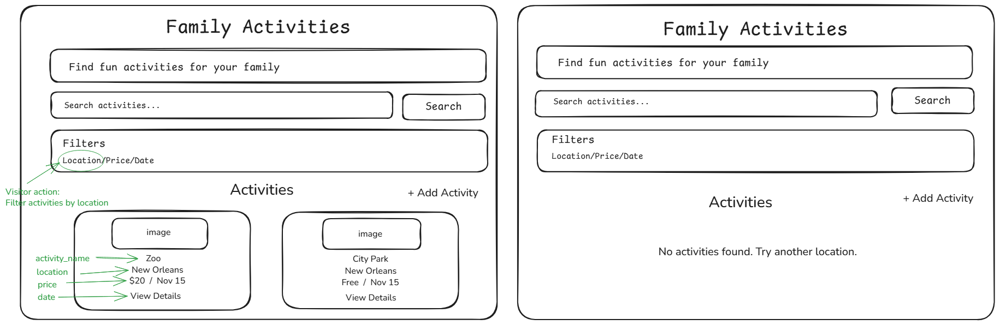

# Family Activities

## About
Family Activities helps parents find and organize fun activities to do with their children.

## User Persona
Sarah is a busy mother of two. She wants to find fun activities for her children, but planning family outings can take a lot of time.

## Problem
Parents need an easy way to find and organize family activities because planning things to do with children can be time-consuming.

## In This Version
1. A visitor can see a list of family activities.
2. A visitor can add a new activity.
3. A visitor can search and filter activities.

## Left Out
- User accounts - not needed because visitors can browse activities without signing in.
- Reviews and ratings - not included in this version to keep the app simple.

## Database
The app uses a Supabase table called `activities`.

| Column | Type |
|---|---|
| id | int8 |
| created_at | timestamptz |
| activity_name | text |
| location | text |
| price | int4 |
| date | date |

## How It Works

The app is built with React and uses Supabase to store family activities. The `useTable` hook loads activity records from the `activities` table when the page opens. React displays the activities using `map()`. Visitors can add, search, edit, and delete activities. The app also shows the total number of activities on the page.

## Changes Since Week 7

Since Week 7, I added activity cards, a search bar, and a counter showing how many activities were found. I also added the ability to delete and edit activities, with Save Changes and Cancel buttons.

## Wireframe
See `wireframe.png` for the app layout.

## Team

[Pod Capstone Plan](https://docs.google.com/document/d/1pAHUoA0O_Pil3cmCH792l70D3B6yPkERFIBjfPNTCwY/edit?tab=t.0)