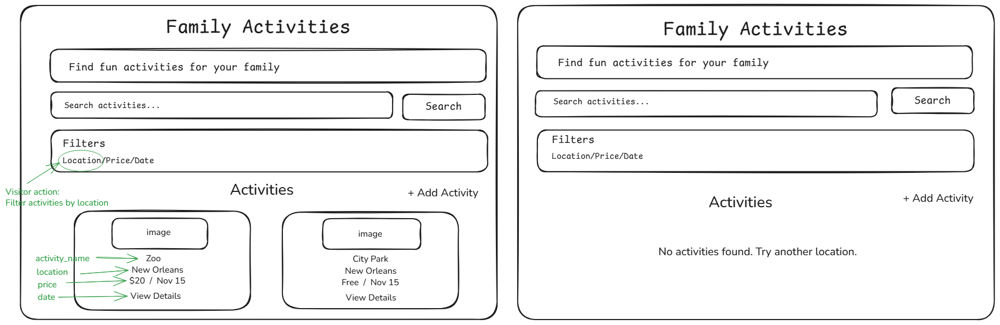

# Family Activities

## About
Family Activities helps parents find and organize fun activities to do with their children.

## User Persona
Sarah is a busy mother of two. She wants to find fun activities for her children, but planning family outings can take a lot of time.

## Problem
Parents need an easy way to find and organize family activities because planning things to do with children can be time-consuming.

## In This Version
1. A visitor can see a list of family activities.
2. A visitor can add a new activity.
3. A visitor can search and filter activities.

## Out of Scope
- User accounts
- Online payments
- Reviews and ratings

## Database
The app uses a Supabase table called `activities`.

| Column | Type |
|---|---|
| activity_name | text |
| location | text |
| price | int4 |
| date | date |

## Wireframe
See `wireframe.png` for the app layout.
